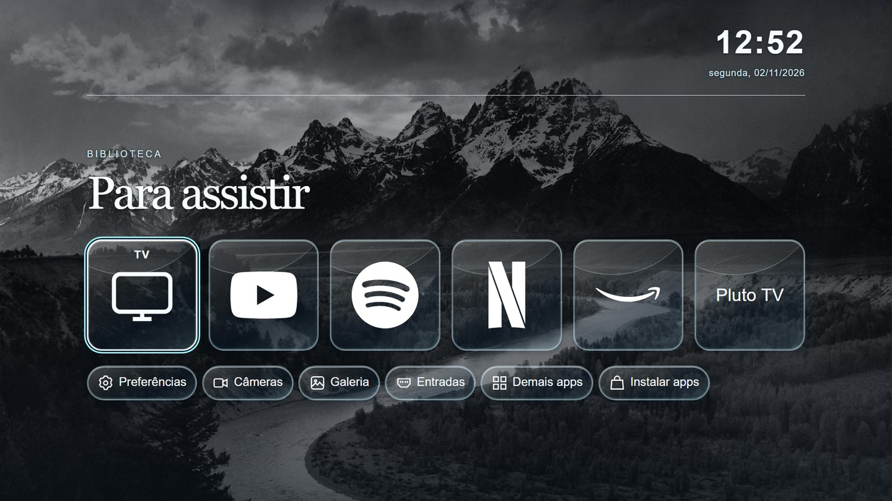
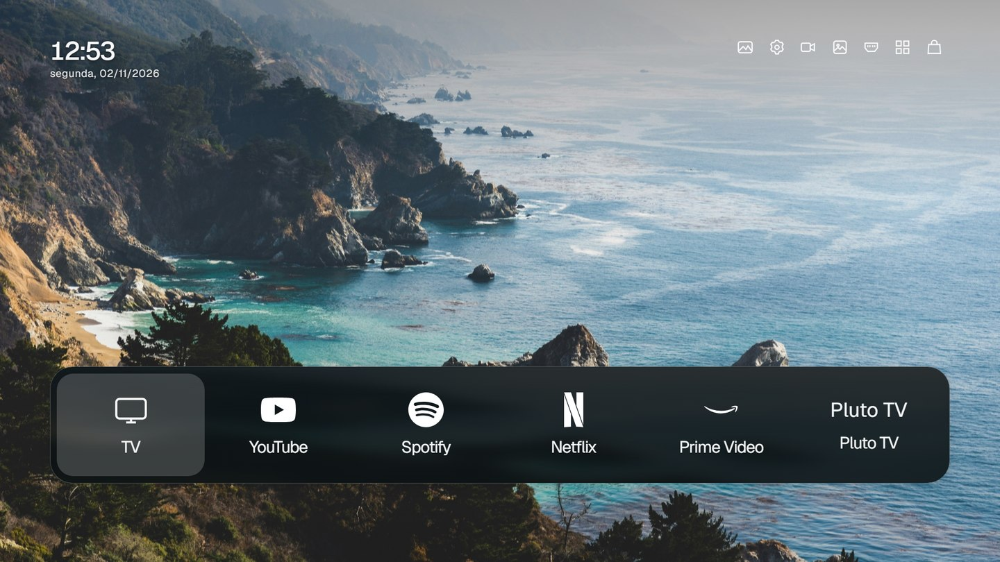
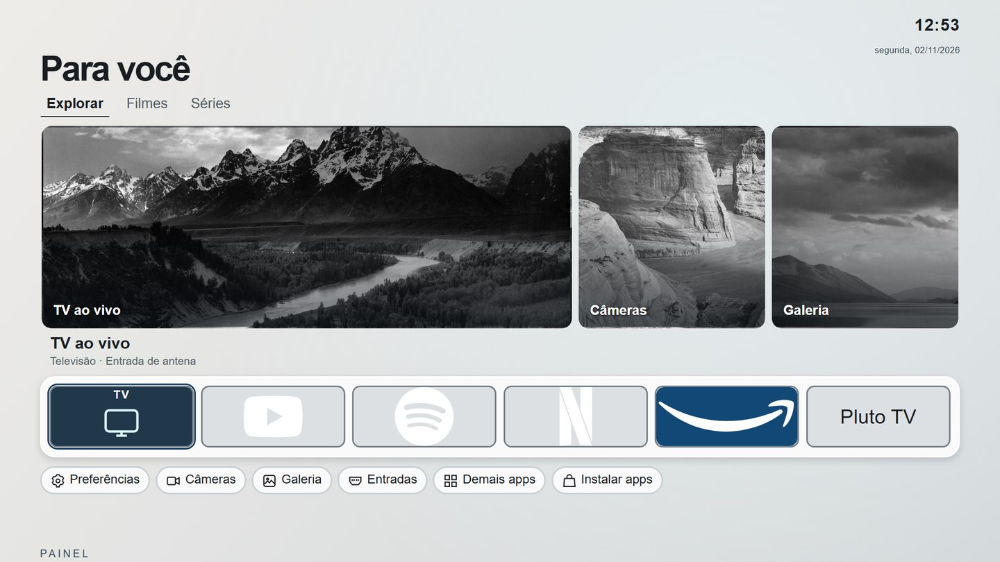

# Lume para LG webOS TV

Launcher em português para controle remoto, com os temas Liquid Glass, Costa e Ateliê, biblioteca de aplicativos, entradas da TV, câmeras Agent DVR e galeria Immich.

**[Baixar o aplicativo](downloads/com.lume.launcher_1.0.0_all.ipk)** · **[Instalação em PDF](docs/guia-de-instalacao.pdf)** · [Guia em LaTeX](docs/instalacao.tex)

A edição pública usa o ID `com.lume.launcher`. O alvo é webOS TV 4.x com Developer Mode. Apps, entradas e pareamento variam por modelo. O botão Home físico continua sob controle do webOS.

## Temas

Prévias da tela inicial da edição pública, renderizadas no navegador em formato 16:9.

### Liquid Glass

### Costa

### Ateliê

## Comparativo de desempenho

Medições históricas em uma TV LG com webOS 4.x. Cada coluna resume uma rodada de aproximadamente 61 segundos, com 31 leituras de memória e 30 intervalos de CPU. A coluna Lume corresponde à versão **0.3.1 com Liquid Glass**. A edição pública 1.0.0 e os outros temas ainda não têm medições equivalentes.

| Sistema: mediana [mín.–máx.] | Developer Mode | Home LG | Lume | Diferença Lume − Home |
|---|---:|---:|---:|---:|
| CPU ativa (%) | 16,8 [11,8–20,8] | 23,0 [19,4–27,5] | 8,1 [6,1–12,1] | -15,0 p.p. |
| RAM disponível (MiB) | 210,4 [210,1–210,8] | 205,1 [191,9–205,5] | 168,2 [167,2–169,4] | -36,9 MiB |
| RAM livre (MiB) | 32,0 [31,7–32,4] | 36,5 [18,5–36,9] | 23,3 [18,6–27,0] | -13,2 MiB |
| Cache (MiB) | 158,1 [158,1–158,1] | 155,6 [155,6–158,0] | 140,5 [138,3–143,4] | -15,1 MiB |
| Swap usada (MiB) | 293,6 [293,5–293,6] | 293,2 [288,9–293,2] | 401,7 [400,7–402,6] | +108,5 MiB |

A CPU ativa foi menor na rodada do Lume, mas também havia menos RAM disponível e mais swap em uso. Os contadores abrangem toda a TV, inclusive aplicativos em segundo plano. A Home LG foi medida após cerca de 91 minutos de atividade e o Lume após 19 minutos. Uma rodada por condição não permite atribuir as diferenças ao launcher nem estimar o tempo de resposta do controle.

## Primeiro uso e privacidade

Os cartões iniciais são sugestões. Em **Demais apps**, atualize a lista e aceite o pareamento na sua TV para descobrir os apps instalados. A lista inicial e a cidade ficam vazias. Em **Preferências → Servidores locais**, configure opcionalmente os endereços do Immich e do Agent DVR. O mosaico aceita até duas câmeras.

Endereços, chaves de API, pareamento e preferências são guardados no armazenamento local do app. Pessoas que usam a TV compartilham o acesso concedido. A troca do endereço do Immich descarta a chave salva. Revogue a chave no Immich para encerrar o acesso. Use HTTPS com certificado aceito pela TV quando disponível. Com HTTP, a chave e o conteúdo trafegam sem criptografia na rede local.

A previsão consulta o Open-Meteo com a pesquisa e as coordenadas da cidade selecionada. O câmbio usa Frankfurter. As recomendações opcionais do Ateliê consultam TMDB com a credencial do usuário. Esses provedores recebem o IP de saída quando consultados. O loopback da descoberta de apps representa a própria TV.

## Reconstrução

Na raiz do repositório, com o perfil TV da webOS CLI, execute `ares-package app service -o downloads`. Créditos dos recursos em [app/CREDITOS.txt](app/CREDITOS.txt) e [app/costa/NOTICES.md](app/costa/NOTICES.md).
